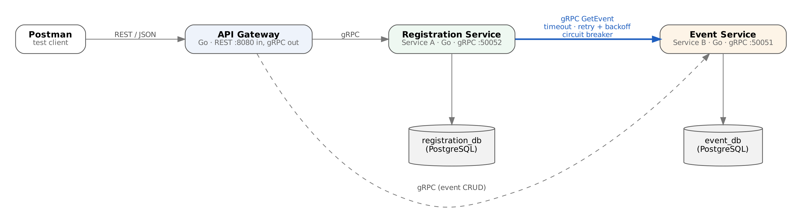
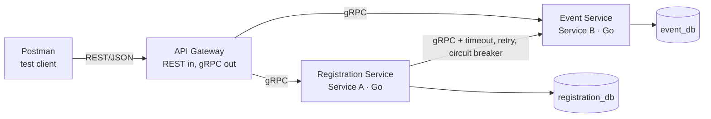

# Campus Events — Two Collaborating Microservices

WEB303 Microservices & Serverless Applications · Programming Assignment 1

A small distributed system for **campus events**. Student clubs publish events
(a hackathon, a football match, a guest lecture) and students register for them.

| Service | Role in the brief | Owns | Database | Port |
|---|---|---|---|---|
| **event-service** | Service B (independent resource) | Events | `event_db` (PostgreSQL) | 50051 (gRPC) |
| **registration-service** | Service A (dependent resource) | Registrations | `registration_db` (PostgreSQL) | 50052 (gRPC) |
| **gateway** | API Gateway | — | — | 8080 (REST) |

A registration always belongs to an event, so before the Registration Service
stores one it asks the Event Service, over gRPC, whether the event exists and
how many places it has.

## Architecture





- Postman talks **only** to the gateway (only port 8080 is published).
- The gateway translates REST calls into gRPC calls and maps gRPC status codes to HTTP status codes.
- The Registration Service reaches event data **only** through the Event Service's gRPC API, never its database.
- Each service has its own PostgreSQL container (Database per Service). `registrations.event_id` is
  deliberately **not** a foreign key, because the events table lives in another database.

### Bounded contexts

| Context | Knows about | Does not know about |
|---|---|---|
| **Events** | title, venue, date, capacity, organizer | who registered |
| **Registrations** | which student registered for which event id, contact details | event details (fetched live, never copied into its DB) |

## Running the system

Requirements: Docker Desktop (or Docker Engine with the Compose plugin). Go is **not** needed.

```bash
docker compose up --build
```

That one command builds the three images and starts five containers
(2 databases, 2 services, gateway). Wait for `[gateway] REST API listening on :8080`, then:

```bash
curl http://localhost:8080/health      # {"status": "ok"}
```

Stop everything with `Ctrl+C`, then `docker compose down`
(add `-v` to also delete the database volumes and start fresh).

## REST API

Base URL: `http://localhost:8080`

| Method | URL | Description | Success |
|---|---|---|---|
| GET | `/health` | Gateway health check | 200 |
| POST | `/events` | Create an event | 201 |
| GET | `/events` | List events | 200 |
| GET | `/events/{id}` | Get one event | 200 |
| PUT | `/events/{id}` | Replace an event | 200 |
| DELETE | `/events/{id}` | Delete an event | 200 |
| POST | `/registrations` | Register a student (**calls Event Service**) | 201 |
| GET | `/registrations` | List registrations (optional `?event_id=1`) | 200 |
| GET | `/registrations/{id}` | Get one registration with live event details (**calls Event Service**) | 200 |
| PUT | `/registrations/{id}` | Update student name / email | 200 |
| DELETE | `/registrations/{id}` | Cancel a registration | 200 |

Example bodies:

```json
POST /events
{ "title": "Inter-College Hackathon", "venue": "CST Auditorium",
  "event_date": "2026-11-14", "capacity": 50, "organizer": "IT Club" }

POST /registrations
{ "event_id": 1, "student_name": "Pema Wangmo",
  "student_id": "02240365", "email": "pema@rub.edu.bt" }
```

Every error has the same shape:

```json
{ "error": { "status": 404, "code": "NOT_FOUND", "message": "event 99 not found" } }
```

### gRPC → HTTP status mapping (`gateway/errors.go`)

| gRPC code | HTTP | Example |
|---|---|---|
| `INVALID_ARGUMENT` | 400 Bad Request | missing title, bad email, malformed JSON |
| `NOT_FOUND` | 404 Not Found | event or registration does not exist |
| `ALREADY_EXISTS` | 409 Conflict | student already registered for that event |
| `FAILED_PRECONDITION` | 409 Conflict | event is full |
| `UNAVAILABLE` | 503 Service Unavailable | Event Service down / circuit breaker open |
| `DEADLINE_EXCEEDED` | 504 Gateway Timeout | service too slow |
| `INTERNAL` | 500 Internal Server Error | unexpected database error |

### Validation rules

Invalid requests are rejected **before** anything is written to a database.

| Field | Rule |
|---|---|
| `title` | required, 3–100 characters |
| `venue`, `organizer` | required, max 100 characters |
| `event_date` | required, a real date in `YYYY-MM-DD` format |
| `capacity` | whole number, 1–5000 |
| `event_id` | required, positive, and the event must exist (checked over gRPC) |
| `student_name` | required, 2–100 characters |
| `student_id` | exactly 8 digits, e.g. `02240365` |
| `email` | valid email address |
| request body | valid JSON, single object, no unknown fields |
| `{id}` in URL | positive whole number |

Business rules: one registration per student per event (409), and no
registrations beyond the event's capacity (409).

## Resilience (Registration Service → Event Service)

Implemented in `registration-service/eventclient.go`:

```
caller ─► circuit breaker ─► retry loop ─► [timeout] gRPC GetEvent ─► Event Service
```

| Pattern | Setting | Behaviour |
|---|---|---|
| **Timeout** | `EVENT_CALL_TIMEOUT=2s` | Every attempt has its own deadline, so a frozen Event Service cannot hang a request. |
| **Retry + exponential backoff** | `EVENT_MAX_RETRIES=3`, `EVENT_RETRY_BACKOFF=200ms` | Up to 4 attempts, waiting 200 → 400 → 800 ms (+ jitter). Only `UNAVAILABLE`, `DEADLINE_EXCEEDED`, `RESOURCE_EXHAUSTED`, `INTERNAL` are retried; `NOT_FOUND` is never retried. |
| **Circuit breaker** (`sony/gobreaker`) | `CB_FAILURE_THRESHOLD=3`, `CB_OPEN_TIMEOUT=15s` | After 3 consecutive failed calls the breaker **opens** and calls fail in ~1 ms without touching the network. After 15 s one trial call is allowed (**half-open**); success **closes** it again. A `NOT_FOUND` reply does not count as a failure. |

What the user sees when the Event Service is stopped:

- `POST /registrations` → **503** `"event service is unavailable (gave up after 4 attempts)…"`, and nothing is stored.
- Once the breaker is open → **503** `"event service is unavailable (circuit breaker is OPEN); please try again in 15s"` instantly.
- `GET /registrations/{id}` → **200 fallback**: the registration is still returned (it is Service A's own data), without
  the `event` block and with an `event_lookup_error` explaining why.
- `GET /registrations` keeps working because it only reads `registration_db`.

### Trying it yourself

```bash
docker compose stop event-service                 # simulate a crash
# send POST /registrations a few times from Postman (folder 5)
docker compose logs -f registration-service       # watch attempts 1/4..4/4 and "closed -> open"
docker compose start event-service                # recover
# after 15 s the next request goes through: "open -> half-open", "half-open -> closed"
```

To simulate a **hung** service instead of a crashed one (tests the timeout):
`docker compose pause event-service` … `docker compose unpause event-service`.

## Configuration

All configuration comes from environment variables, set in `.env` and passed in by
`docker-compose.yml`. Nothing environment-specific is hard-coded.

| Variable | Used by | Default in `.env` |
|---|---|---|
| `GATEWAY_PORT` | gateway | 8080 |
| `EVENT_SERVICE_PORT` | event-service, others to reach it | 50051 |
| `REGISTRATION_SERVICE_PORT` | registration-service, gateway | 50052 |
| `EVENT_DB_NAME` / `_USER` / `_PASSWORD` | event-db, event-service | event_db / event_user / event_pass |
| `REGISTRATION_DB_NAME` / `_USER` / `_PASSWORD` | registration-db, registration-service | registration_db / … |
| `EVENT_CALL_TIMEOUT` | registration-service | 2s |
| `EVENT_MAX_RETRIES` | registration-service | 3 |
| `EVENT_RETRY_BACKOFF` | registration-service | 200ms |
| `CB_FAILURE_THRESHOLD` | registration-service | 3 |
| `CB_OPEN_TIMEOUT` | registration-service | 15s |
| `GATEWAY_REQUEST_TIMEOUT` | gateway | 15s |

Inside the containers the services read `GRPC_PORT`, `HTTP_PORT`, `DB_HOST`, `DB_PORT`, `DB_NAME`,
`DB_USER`, `DB_PASSWORD`, `EVENT_SERVICE_ADDR` and `REGISTRATION_SERVICE_ADDR`; a service exits with a
clear message if a required one is missing.

## Testing with Postman

Import `postman/campus-events.postman_collection.json`. Run the folders in order:

0. **Health**
1. **Events – CRUD**
2. **Registrations – CRUD** (shows the Event Service being called)
3. **Validation** (400s)
4. **Error mapping** (404, 409 duplicate, 409 full)
5. **Resilience**: run `docker compose stop event-service` first (503s, open breaker, fallback)
6. **Clean-up**: run `docker compose start event-service` and wait 15 s first

Each request has tests that check the status code, and IDs are saved into collection variables
automatically. Run it on a fresh database (`docker compose down -v` then `up`) for the expected IDs.

## Project structure

```
campus-events/
├── proto/
│   ├── event/event.proto                 # Event Service contract
│   └── registration/registration.proto   # Registration Service contract
├── gen/                                  # Go code generated from the .proto files
├── event-service/                        # Service B
│   ├── main.go          start-up, gRPC server
│   ├── server.go        gRPC handlers, error codes
│   ├── store.go         SQL for event_db
│   ├── validation.go    input rules
│   └── Dockerfile       multi-stage build
├── registration-service/                 # Service A
│   ├── main.go
│   ├── server.go        handlers, calls Event Service, fallback
│   ├── eventclient.go   timeout + retry + circuit breaker
│   ├── store.go         SQL for registration_db
│   ├── validation.go
│   └── Dockerfile
├── gateway/                              # API Gateway
│   ├── main.go          HTTP server, request logging
│   ├── handlers.go      REST routes → gRPC calls
│   ├── errors.go        gRPC → HTTP status mapping
│   ├── dto.go           JSON request/response shapes
│   └── Dockerfile
├── internal/config/     reads environment variables
├── internal/database/   PostgreSQL connection with start-up retry
├── postman/campus-events.postman_collection.json
├── scripts/gen-proto.sh  regenerates gen/ from proto/
├── docker-compose.yml
└── .env
```

## Regenerating gRPC code

Only needed if you change a `.proto` file:

```bash
go install google.golang.org/protobuf/cmd/protoc-gen-go@v1.34.2
go install google.golang.org/grpc/cmd/protoc-gen-go-grpc@v1.5.1
./scripts/gen-proto.sh
```

## Running without Docker (optional)

With Go 1.22+ and a local PostgreSQL that has `event_db` and `registration_db`:

```bash
GRPC_PORT=50051 DB_HOST=localhost DB_PORT=5432 DB_USER=postgres DB_PASSWORD=postgres DB_NAME=event_db \
  go run ./event-service
GRPC_PORT=50052 DB_HOST=localhost DB_PORT=5432 DB_USER=postgres DB_PASSWORD=postgres DB_NAME=registration_db \
  EVENT_SERVICE_ADDR=localhost:50051 go run ./registration-service
HTTP_PORT=8080 EVENT_SERVICE_ADDR=localhost:50051 REGISTRATION_SERVICE_ADDR=localhost:50052 \
  go run ./gateway
```
